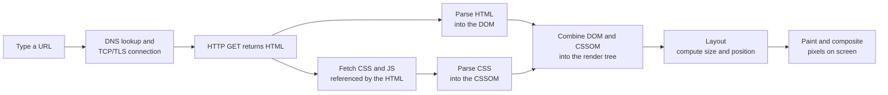
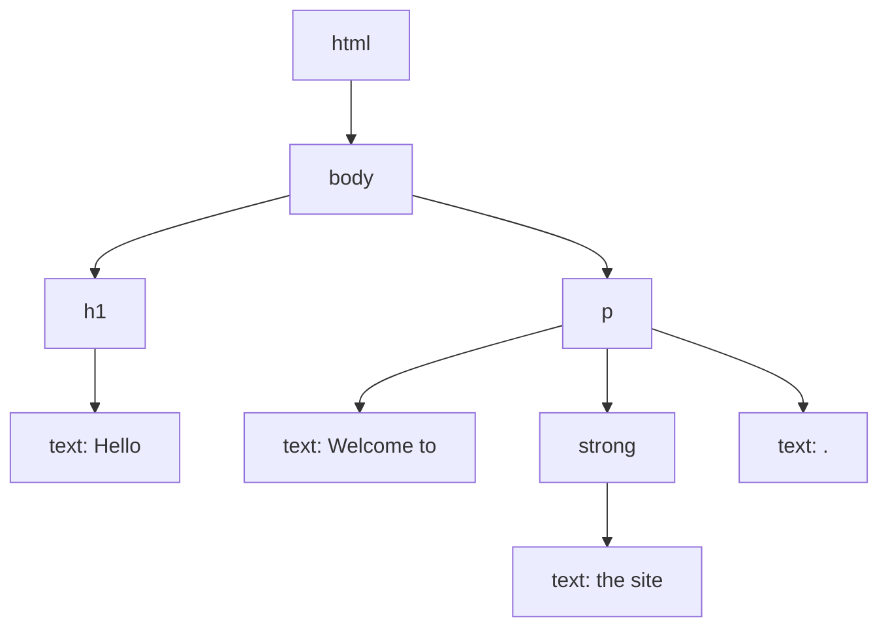

# Module 01 — How the Browser Works

## 1. From URL to pixels

A browser is a program that fetches documents over HTTP (Systems course, Module 03), turns them into a tree of objects, works out how big and where everything goes, and paints it.



Three terms to hold on to:

- **DOM (Document Object Model)** — the page as a tree of objects. Every tag becomes a node you can read and change from JavaScript.
- **CSSOM** — the same idea for styles: a tree of rules the browser can look up.
- **Render tree** — only what is actually displayed (an element with `display: none` is in the DOM but not in the render tree).

## 2. Parsing HTML into the DOM

```html
<!DOCTYPE html>
<html>
  <body>
    <h1>Hello</h1>
    <p>Welcome to <strong>the site</strong>.</p>
  </body>
</html>
```

becomes:



If the HTML is malformed, the browser does not stop with an error. It guesses what you meant and builds a DOM anyway. That forgiving behaviour is why a missing closing tag can produce a bug far from where you made the typo.

## 3. Render-blocking: why script placement matters

The parser stops when it meets a plain `<script>` tag, downloads and runs it, then continues. CSS blocks rendering because the browser will not paint until it knows the styles.

| Pattern | Behaviour |
| --- | --- |
| `<script src="app.js"></script>` | Blocks HTML parsing while it downloads and runs |
| `<script src="app.js" defer></script>` | Downloads in parallel, runs after the HTML is parsed, in order |
| `<script src="app.js" async></script>` | Downloads in parallel, runs as soon as it arrives, in any order |
| `<script type="module" src="app.js"></script>` | Deferred by default and supports `import`/`export` |

Rule of thumb: put scripts in the `<head>` with `defer` (or use `type="module"`).

## 4. The browser is a runtime too

Besides rendering, the browser runs your JavaScript. It exposes browser-only APIs that are not part of the language itself:

| API | What it gives you |
| --- | --- |
| `document` | The DOM: find, create and change elements |
| `window` | The tab: location, history, timers |
| `fetch` | Make HTTP requests |
| `localStorage` | Small key-value storage that survives reloads |
| `console` | Logging to the dev tools console |

JavaScript in the browser is single-threaded. Long-running code blocks painting and clicks, which is why slow handlers make a page feel frozen.

## 5. Same-origin policy and CORS

A page loaded from `https://app.example.com` is not allowed, by default, to read responses from `https://api.other.com`. This is the **same-origin policy**. A server opts in by sending CORS headers, for example `Access-Control-Allow-Origin`.

```bash
# See the CORS header a public API returns
curl -sI https://api.github.com | grep -i access-control
```

When you see `blocked by CORS policy` in the console, the fix is on the server (or via a proxy), not in your frontend code.

## Try it yourself

1. Open any website, right-click, choose **Inspect**, and open the **Elements** tab. Expand a few nodes: this is the live DOM.
2. In the **Network** tab, reload the page and click the first request. Find the status code, request headers and response headers.
3. In the Console, run `document.title`, then `document.body.style.background = 'lightyellow'` and watch the page change.

## Key takeaways

- The browser builds a DOM from HTML and a CSSOM from CSS, combines them, lays out, then paints
- Scripts can block parsing; use `defer` or modules
- The page you see is the live DOM, which JavaScript can change at any time
- CORS errors are a server configuration matter

**Next:** [Module 02 — HTML](../02-html/README.md)
