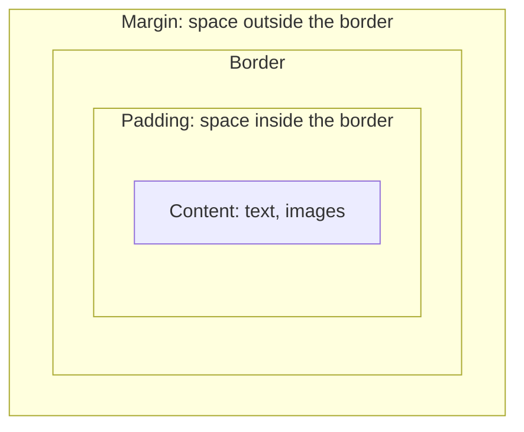

# Module 03 — CSS

CSS controls presentation: colour, spacing, typography and layout.

## 1. A rule, and how it is applied

```css
h1 {
  color: #0a5;
  font-size: 2rem;
}
```

`h1` is the **selector**, `color` is a **property**, `#0a5` is a **value**. Link a stylesheet from the HTML `<head>` with `<link rel="stylesheet" href="style.css" />`.

| Selector | Matches |
| --- | --- |
| `p` | every `<p>` |
| `.card` | elements with `class="card"` |
| `#header` | the element with `id="header"` (ids must be unique) |
| `nav a` | any `<a>` inside a `<nav>` |
| `a:hover` | a link while the pointer is over it |
| `.card > h2` | an `h2` that is a direct child of `.card` |

## 2. The cascade and specificity

When several rules target the same element, the browser picks the winner by (1) importance, (2) specificity (id beats class beats element), then (3) source order, with later rules winning ties. Inheritance means some properties (colour, font) pass from parent to child automatically.

Practical advice: style with classes, keep selectors shallow, and treat `!important` as a code smell.

## 3. The box model

Every element is a rectangular box made of four layers.



```css
* {
  box-sizing: border-box; /* width includes padding and border: far easier to reason about */
}
.card {
  width: 300px;
  padding: 16px;
  border: 1px solid #ccc;
  margin: 24px auto;
}
```

Without `box-sizing: border-box`, a 300px-wide box with 16px padding and a border is actually 334px wide, a classic source of layout surprises.

## 4. Units

| Unit | Meaning |
| --- | --- |
| `px` | Fixed pixels |
| `rem` | Relative to the root font size; good for spacing and type |
| `em` | Relative to the element's own font size |
| `%` | Relative to the parent |
| `vw` / `vh` | Percentage of the viewport width / height |

## 5. Layout with Flexbox

Flexbox lays items out along **one axis** (a row or a column).

```html
<nav class="bar">
  <a href="/">Home</a>
  <a href="/docs">Docs</a>
  <a href="/login" class="push">Log in</a>
</nav>
```

```css
.bar {
  display: flex;
  gap: 16px;
  align-items: center;       /* cross axis */
  justify-content: flex-start; /* main axis */
}
.push {
  margin-left: auto;         /* pushes this item to the far end */
}
```

## 6. Layout with Grid

Grid lays items out in **two dimensions** (rows and columns).

```css
.gallery {
  display: grid;
  grid-template-columns: repeat(auto-fill, minmax(200px, 1fr));
  gap: 16px;
}
```

This one declaration produces a responsive gallery: as many 200px-minimum columns as fit, sharing leftover space equally.

| Use | When |
| --- | --- |
| Flexbox | A row or column of items: navbars, button groups, centring one thing |
| Grid | A two-dimensional layout: page shells, card galleries |

## 7. Responsive design

Design for small screens first, then add rules for larger ones using **media queries**.

```css
.layout {
  display: grid;
  gap: 16px;
}
@media (min-width: 768px) {
  .layout {
    grid-template-columns: 1fr 3fr; /* sidebar + content on wider screens */
  }
}
```

Test by toggling the device toolbar in dev tools (Module 07).

## 8. Custom properties (variables)

```css
:root {
  --brand: #0a5;
  --space: 16px;
}
.button {
  background: var(--brand);
  padding: var(--space);
}
```

## 9. A tiny reset that prevents most surprises

```css
*, *::before, *::after { box-sizing: border-box; }
body { margin: 0; font-family: system-ui, sans-serif; line-height: 1.5; }
img { max-width: 100%; display: block; }
```

## Try it yourself

1. Build the `.bar` navbar above and make the last link sit at the far right.
2. Build the `.gallery` grid with 8 coloured `<div>`s and resize the browser window.
3. Inspect any element, open the **Computed** panel and find its box-model diagram.

## Key takeaways

- Everything is a box: content, padding, border, margin
- Use `box-sizing: border-box` globally
- Flexbox for one dimension, Grid for two
- Mobile-first with `min-width` media queries

**Next:** [Module 04 — JavaScript](../04-javascript/README.md)
