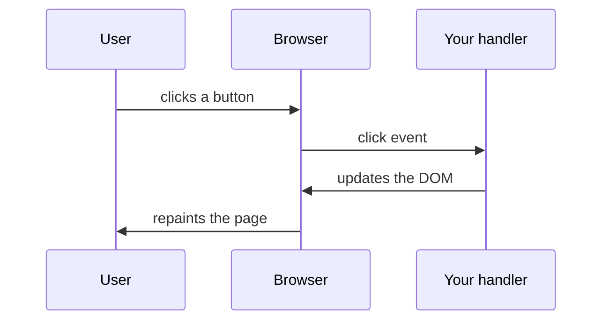
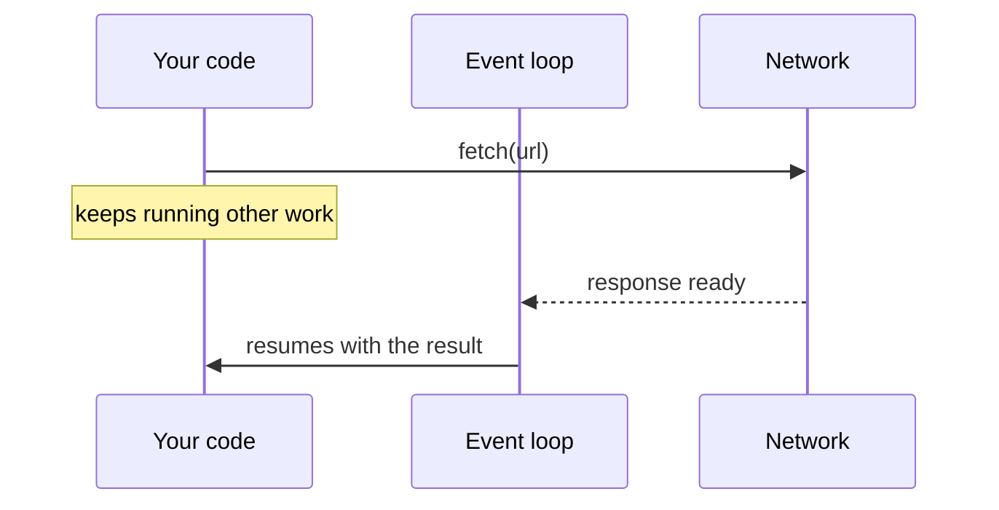

# Module 04 — JavaScript

JavaScript adds behaviour. It runs in the browser (and, via Node.js, on servers).

## 1. Language essentials

```js
const name = "Amina";        // cannot be reassigned
let count = 0;               // can be reassigned
count += 1;

const user = { name, age: 29, skills: ["git", "sql"] };  // object
const doubled = [1, 2, 3].map((n) => n * 2);             // [2, 4, 6]

function greet(person) {
  return `Hello, ${person.name}`;   // template literal
}

if (count > 0 && user.skills.includes("git")) {
  console.log(greet(user));
}
```

| Concept | Notes |
| --- | --- |
| `const` / `let` | Prefer `const`; avoid `var` |
| Types | string, number, boolean, `null`, `undefined`, object, array (an object), function |
| Equality | Use `===` and `!==`; `==` converts types in surprising ways |
| Arrays | `map`, `filter`, `reduce`, `find`, `includes`, `forEach` |
| Destructuring | `const { name, age } = user;` and `const [first, second] = list;` |
| Optional chaining | `user.address?.city` returns `undefined` instead of throwing |
| Modules | `export` / `import` split code across files |

Run snippets quickly with Node: `node -e "console.log([1,2,3].map(n => n * 2))"`.

## 2. Talking to the DOM

```html
<button id="add">Add</button>
<ul id="list"></ul>
```

```js
const list = document.querySelector("#list");
const button = document.querySelector("#add");

let n = 0;
button.addEventListener("click", () => {
  n += 1;
  const li = document.createElement("li");
  li.textContent = `Item ${n}`;
  list.append(li);
});
```

The pattern is always: **find** an element, **listen** for an event, **change** the DOM.

Use `textContent` (not `innerHTML`) when inserting text a user or API supplied. Putting untrusted data in `innerHTML` is how cross-site scripting (XSS) bugs happen.

## 3. Events



Common events: `click`, `input`, `submit`, `keydown`, `DOMContentLoaded`. For forms, call `event.preventDefault()` to stop the browser's default full-page submit.

## 4. Asynchronous JavaScript

Network calls take time. JavaScript does not wait; it schedules a callback and carries on, so the page stays responsive.



A **Promise** represents a value that will exist later. `async`/`await` is the readable way to use them.

```js
async function loadUser(id) {
  const response = await fetch(`https://jsonplaceholder.typicode.com/users/${id}`);
  if (!response.ok) {
    throw new Error(`Request failed: ${response.status}`);
  }
  return response.json();   // also async
}

loadUser(1)
  .then((user) => console.log(user.name))
  .catch((error) => console.error(error));
```

Two things agents (and people) routinely forget:

1. `fetch` does **not** reject on a 404 or 500. Check `response.ok`.
2. Handle failure: show the user something when the network fails.

## 5. Putting it together: fetch and render

```js
const container = document.querySelector("#users");

async function showUsers() {
  container.textContent = "Loading...";
  try {
    const response = await fetch("https://jsonplaceholder.typicode.com/users");
    if (!response.ok) throw new Error(`HTTP ${response.status}`);
    const users = await response.json();

    container.replaceChildren(
      ...users.map((u) => {
        const li = document.createElement("li");
        li.textContent = `${u.name} (${u.email})`;
        return li;
      })
    );
  } catch (error) {
    container.textContent = `Could not load users: ${error.message}`;
  }
}

showUsers();
```

Three UI states appear in nearly every data-driven screen: **loading**, **error**, **success** (and often **empty**). Build all of them.

## 6. Modules

```js
// math.js
export const add = (a, b) => a + b;

// app.js
import { add } from "./math.js";
console.log(add(2, 3));
```

Use `<script type="module" src="app.js"></script>` in the browser.

## Try it yourself

1. Paste the add-button snippet into a page and make it work.
2. Open the Console and run `fetch("https://jsonplaceholder.typicode.com/todos/1").then(r => r.json()).then(console.log)`.
3. Change the URL in the snippet in section 5 to a bad address and confirm the error message shows.

## Key takeaways

- Find, listen, change: the loop behind all DOM code
- `fetch` returns a Promise; check `response.ok`; handle errors
- Every data-driven view needs loading, error and success states
- Never put untrusted data in `innerHTML`

**Next:** [Module 05 — React Fundamentals](../05-react-fundamentals/README.md)
