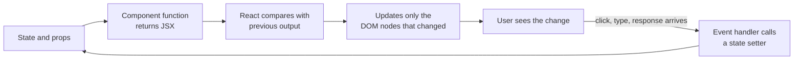

# Module 05 — React Fundamentals

React is a library for building user interfaces out of reusable pieces called **components**. Instead of finding elements and changing them by hand (Module 04), you describe what the UI should look like for the current data, and React updates the DOM to match.

## 1. Why it exists

Hand-written DOM code gets hard to keep correct as state grows: every change must remember to update every place that shows it. React flips this around.



## 2. Components and JSX

A component is a function that returns JSX, an HTML-like syntax inside JavaScript.

```jsx
function Greeting({ name }) {
  return <h1>Hello, {name}</h1>;
}

export default function App() {
  return (
    <main>
      <Greeting name="Amina" />
      <Greeting name="Kamau" />
    </main>
  );
}
```

| Rule | Why |
| --- | --- |
| Component names start with a capital letter | Lowercase means an HTML tag |
| Return one root element (or a `<>...</>` fragment) | A function returns one value |
| `{ }` embeds a JavaScript expression | Values, calls, ternaries, `.map()` |
| Use `className`, not `class` | `class` is reserved in JavaScript |

## 3. Props: data flowing down

Props are the inputs to a component. They flow **one way**, from parent to child, and a child must not modify them.

```jsx
function UserCard({ name, email }) {
  return (
    <li>
      <strong>{name}</strong> — {email}
    </li>
  );
}
```

## 4. State: data that changes

```jsx
import { useState } from "react";

function Counter() {
  const [count, setCount] = useState(0);

  return (
    <button onClick={() => setCount(count + 1)}>
      Clicked {count} times
    </button>
  );
}
```

`useState` returns the current value and a setter. Calling the setter tells React to run the component again with the new value. Never change state directly (`count++`); always use the setter.

## 5. Rendering lists and conditionals

```jsx
function UserList({ users }) {
  if (users.length === 0) return <p>No users yet.</p>;

  return (
    <ul>
      {users.map((u) => (
        <UserCard key={u.id} name={u.name} email={u.email} />
      ))}
    </ul>
  );
}
```

The `key` must be a stable, unique id so React can track which item is which. Using the array index breaks when the list is reordered.

## 6. Side effects and data fetching

`useEffect` runs code after render, for things outside React's rendering: network calls, timers, subscriptions.

```jsx
import { useEffect, useState } from "react";

function Users() {
  const [users, setUsers] = useState([]);
  const [status, setStatus] = useState("loading"); // "loading" | "error" | "ready"

  useEffect(() => {
    let cancelled = false;

    async function load() {
      try {
        const res = await fetch("https://jsonplaceholder.typicode.com/users");
        if (!res.ok) throw new Error(`HTTP ${res.status}`);
        const data = await res.json();
        if (!cancelled) {
          setUsers(data);
          setStatus("ready");
        }
      } catch {
        if (!cancelled) setStatus("error");
      }
    }

    load();
    return () => {
      cancelled = true; // ignore the result if the component went away
    };
  }, []); // [] = run once, after the first render

  if (status === "loading") return <p>Loading...</p>;
  if (status === "error") return <p>Something went wrong.</p>;
  return <UserList users={users} />;
}
```

The array at the end, the **dependency array**, lists the values the effect uses. React re-runs the effect when one changes. A wrong or missing dependency is one of the most common React bugs, and a classic thing to check in generated code.

## 7. The mental model to keep

| Idea | Meaning |
| --- | --- |
| UI = function(state) | The screen is a result of the data; change the data, not the DOM |
| Props down, events up | Data goes to children via props; children tell parents via callback props |
| Lift state up | If two components need the same data, keep it in their nearest common parent |
| Components are re-run often | Keep them quick and free of side effects outside `useEffect` |

## 8. A note on when to use a framework at all

Plain HTML, CSS and JS are enough for a simple page. Reach for React when you have lots of interactive state shared across a page. The wider ecosystem (routing, data fetching libraries, meta-frameworks such as Next.js) builds on exactly the concepts above.

## Try it yourself

Complete [Lab 02 — Your First React App](../exercises/02-react-app-lab.md).

## Key takeaways

- Describe the UI as a function of state and props; React does the DOM work
- Props flow down, never mutate them; state changes only through setters
- `key` on list items, a dependency array on effects, and loading/error/ready states are the things to check in any generated component

**Next:** [Module 06 — Tooling and Build](../06-tooling-and-build/README.md)
