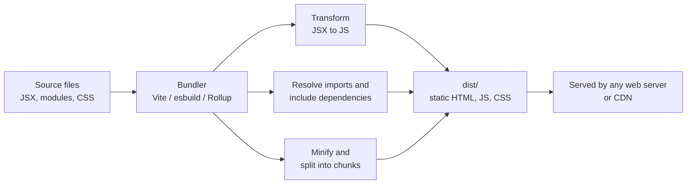

# Module 06 — Tooling and Build

Browsers understand HTML, CSS and JavaScript. Modern projects add dependencies, JSX, and many source files, so a small toolchain turns your source into what the browser runs.

## 1. Node.js and npm

**Node.js** runs JavaScript outside the browser. **npm** is the package manager that installs libraries from the npm registry.

```bash
node --version
npm --version
```

## 2. `package.json`: the project manifest

```json
{
  "name": "my-app",
  "version": "1.0.0",
  "private": true,
  "type": "module",
  "scripts": {
    "dev": "vite",
    "build": "vite build",
    "preview": "vite preview",
    "lint": "eslint ."
  },
  "dependencies": {
    "react": "^18.3.1",
    "react-dom": "^18.3.1"
  },
  "devDependencies": {
    "vite": "^5.4.0"
  }
}
```

| Field | Meaning |
| --- | --- |
| `scripts` | Named commands run with `npm run <name>` (`npm start` and `npm test` need no `run`) |
| `dependencies` | Libraries your app needs at runtime |
| `devDependencies` | Tools only needed while developing or building |
| `^18.3.1` | "Compatible with 18.3.1": allows minor and patch updates, not 19.x |

Two related files:

- `package-lock.json` records the exact versions installed. **Commit it**, so everyone gets identical builds.
- `node_modules/` holds the installed code. **Never commit it**; add it to `.gitignore`.

## 3. Common commands

| Command | What it does |
| --- | --- |
| `npm install` | Install everything listed in `package.json` |
| `npm install <pkg>` | Add a dependency |
| `npm install -D <pkg>` | Add a dev dependency |
| `npm run dev` | Run the dev script |
| `npm run build` | Create the production build |
| `npm ls --depth=0` | List top-level installed packages |
| `npm audit` | Check dependencies for known vulnerabilities |

## 4. What a bundler does



In development, Vite serves your files with instant reload (**hot module replacement**). For production, `npm run build` writes optimised static files to `dist/`.

## 5. Start a React project with Vite

```bash
npm create vite@latest my-app -- --template react
cd my-app
npm install
npm run dev
```

Open the URL it prints (typically `http://localhost:5173`). Edit `src/App.jsx` and watch the page update without a reload.

Project layout you will see:

```
my-app/
├── index.html          entry HTML, loads /src/main.jsx
├── package.json
├── vite.config.js
├── public/             static files copied as-is
└── src/
    ├── main.jsx        mounts <App /> into the page
    ├── App.jsx
    └── App.css
```

## 6. Environment variables

Vite exposes variables prefixed with `VITE_` to your frontend code via `import.meta.env`.

```bash
# .env.local   (never commit)
VITE_API_BASE_URL=https://api.example.com
```

```js
const base = import.meta.env.VITE_API_BASE_URL;
```

**Anything in frontend code is public.** Anyone can open dev tools and read it, so never put secrets or private API keys in a `VITE_` variable or any client-side file.

## 7. Linting and formatting

- **ESLint** flags likely bugs (unused variables, a missing `useEffect` dependency)
- **Prettier** formats code consistently so reviews are about logic, not whitespace

Running `npm run lint` before committing is a cheap way to catch mistakes in generated code too.

## Try it yourself

1. Create the Vite app above and run it.
2. Add a dependency: `npm install dayjs`, import it in `App.jsx` and display today's date.
3. Run `npm run build`, then `npm run preview`, and look inside `dist/`.

## Key takeaways

- `package.json` describes the project; commit it and `package-lock.json`, never `node_modules`
- A bundler turns source into optimised static files; Vite gives a fast dev loop
- Frontend code and `VITE_` variables are public: no secrets

**Next:** [Module 07 — DevTools and Debugging](../07-devtools-and-debugging/README.md)
