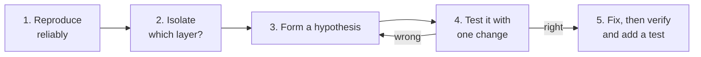

# Module 07 — DevTools and Debugging

Open dev tools with **F12**, **Ctrl+Shift+I** (Cmd+Option+I on macOS), or right-click and choose **Inspect**.

## 1. The panels you will use most

| Panel | Use it to |
| --- | --- |
| **Elements** | See the live DOM, edit HTML and CSS in place, view the box model and computed styles |
| **Console** | See errors and logs; run JavaScript against the current page |
| **Sources** | Read your code, set breakpoints, step through execution |
| **Network** | Inspect every request: URL, status, headers, timing, payload |
| **Application** | Look at `localStorage`, cookies and cached files |
| **Lighthouse** | Audit performance, accessibility and best practices |

## 2. A debugging method that works



Isolating the layer is the key move. Ask which of these is broken:

| Symptom | Likely layer | Where to look |
| --- | --- | --- |
| Element is missing or wrong text | HTML or data | Elements panel; is it in the DOM at all? |
| Element is there but looks wrong | CSS | Elements > Styles and Computed |
| Nothing happens on click | JavaScript | Console errors; breakpoint in the handler |
| Data is wrong or missing | Network or API | Network panel: status code and response body |
| Works locally, fails deployed | Environment or CORS | Network panel and Console |

## 3. Debugging layout (CSS)

1. Right-click the misbehaving element and choose **Inspect**.
2. In **Styles**, untick rules to see their effect; crossed-out rules were overridden.
3. In **Computed**, view the final values and the box-model diagram to find unexpected margins and padding.
4. Click a `display: flex` or `grid` badge in Elements to overlay the layout lines.

## 4. Debugging JavaScript

```js
console.log("user:", user);       // quick look
console.table(users);             // arrays of objects as a table
console.error("failed", error);   // shown in red with a stack trace
debugger;                         // pauses here when dev tools are open
```

Better than scattering `console.log`: in **Sources**, click a line number to add a **breakpoint**, trigger the action, then step with the toolbar (step over, step into, resume) while watching variable values in the **Scope** pane.

Reading an error: the first line says what went wrong, the stack trace says where. Start with the first line of your own code in the trace.

| Common message | Usual cause |
| --- | --- |
| `Cannot read properties of undefined (reading 'x')` | You assumed data existed before it loaded or that a key was present |
| `x is not a function` | Wrong import, wrong type, or a typo in a method name |
| `Unexpected token <` when parsing JSON | The URL returned HTML (often a 404 page), not JSON |
| `Failed to fetch` / `blocked by CORS policy` | Network failure, or the server did not allow your origin |

## 5. Debugging network calls

In the **Network** panel:

1. Reload with the panel open; click the failing request.
2. **Headers** tab: method, URL, status, and request/response headers.
3. **Payload** tab: what you sent. **Response** tab: what came back.
4. Check the status first: 4xx means your request was wrong, 5xx means the server failed.

You can also reproduce a request from the terminal, using the Systems course skills:

```bash
curl -i https://jsonplaceholder.typicode.com/users/1
```

## 6. Debugging React

Install the **React Developer Tools** browser extension. It adds **Components** (see the component tree with live props and state) and **Profiler** panels. When the UI is wrong, find the component, read its state and props, and compare them to what you expected.

## 7. Accessibility and performance checks

- Run **Lighthouse** and read the Accessibility and Performance sections
- In Elements, the **Accessibility** pane shows the accessible name and role of a node
- Tab through the page: is there a visible focus indicator, and can you reach everything?

## Try it yourself

Complete [Lab 03 — Debugging Clinic](../exercises/03-debugging-clinic.md).

## Key takeaways

- Reproduce, isolate the layer, hypothesise, change one thing, verify
- Elements for layout, Console and Sources for logic, Network for data
- Read the first line of an error, then the first frame in your own code

**Next:** start the labs in [`exercises/`](../exercises/01-static-page-lab.md), or return to the [course overview](../README.md).
